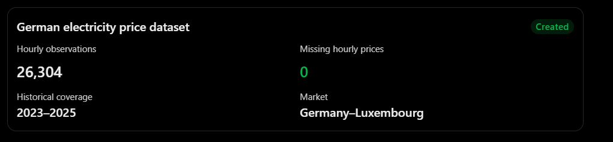
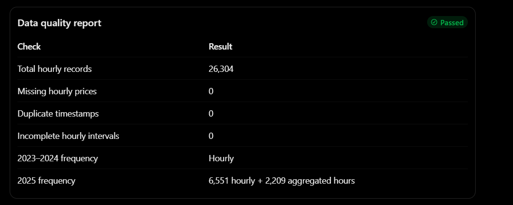
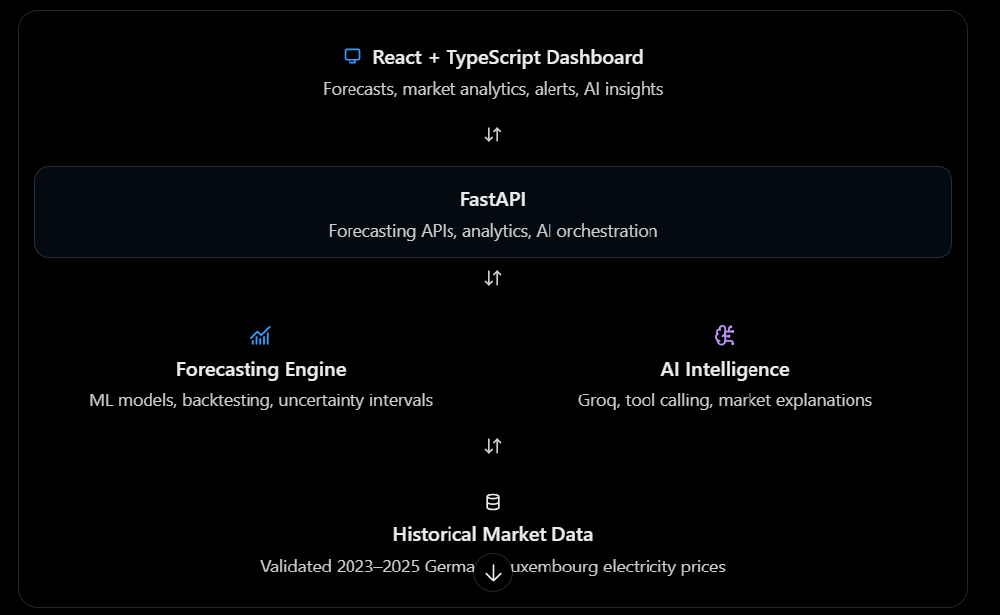
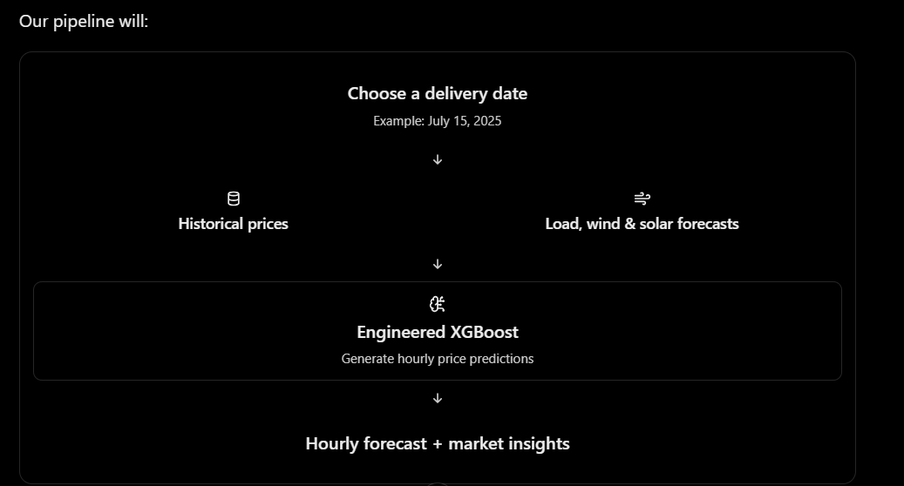
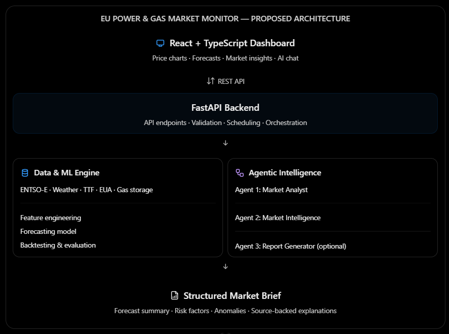

Why I prefer our approach for EU Market Monitor
Electricity prices are influenced by more than recurring seasonal patterns.

For example, prices can change sharply when renewable generation drops, electricity demand rises, or the market experiences unusual conditions.

Our XGBoost model can learn nonlinear relationships between these variables, which makes it a sensible choice for this problem.

Prophet is useful for recurring trends and seasonality, but it isn't automatically better just because it can forecast future dates.
One thing we should learn from their implementation
Their notebook separates training from prediction.

They train their models, save them, and later load the saved models to generate forecasts. Pasted text(1).txt

We've already adopted this principle. Our trained XGBoost model is saved as enriched_xgboost.joblib, so we don't need to retrain every time someone opens the dashboard.

________________________

Goal: to collect approximately 3 years of German day-ahead electricity prices for model training and backtesting.

Germany moved to 15-minute day-ahead market time units in 2025. Therefore, do not expect every year to have exactly 8,760 hourly rows.

all three datasets have a gap near December 30–31, rather than gaps scattered throughout the year.

That suggests we should investigate the ENTSO-E data retrieval or timestamp handling before assuming the market data itself is missing.
What we found
Year	Missing interval	Status
2023	Dec 30, 23:00 UTC	Investigate
2024	Dec 30, 23:00 UTC	Investigate
2025	Dec 30, 23:00 UTC (15 min)	Investigate

The 2025 result is especially interesting because the data contains both hourly and quarter-hourly observations.

The exact missing timestamps:
Year	Missing timestamp (UTC)
2023	2023-12-30 23:00
2024	2024-12-30 23:00
2025	2025-12-30 23:00

The interesting part: The same UTC hour is missing in all three years. This strongly suggests a systematic data retrieval or processing issue rather than three independent missing observations.

The successful smaller queries suggest an issue with the original bulk retrieval or processing. We haven't yet identified the exact cause.

We are preserving the original raw datasets and saving repaired versions separately. That's a good data-engineering practice because we retain an audit trail of the corrections.

Standardize everything to hourly prices
Our forecasting target is hourly German day-ahead electricity prices, so we need to convert the 15-minute observations in 2025 into hourly values.

We'll use the arithmetic mean of the four quarter-hourly prices within each hour. This is appropriate for constructing an equal-duration hourly average price.

Electricity Price Data Preparation is complete.

Exploratory Data Analysis (EDA)
Now we're going to understand how German electricity prices behaved from 2023 to 2025.

Our first notebook will eventually answer four questions:
1. How have average electricity prices changed?
2. When are prices most volatile?
3. How frequently do negative electricity prices occur?
4. Are there recognizable hourly, weekly and seasonal patterns?

Development roadmap

Historical data pipeline

Cleaning, validation, EDA and anomaly detection

02

FastAPI backend

Expose market statistics, historical prices and anomalies

03

React dashboard

Build a polished, interactive market monitoring interface

04

AI Market Analyst

Natural-language questions grounded in calculated market data

05

Forecasting and intelligence

Price forecasting, alert explanations and model evaluation

One detail matters before writing that code: because your dataset ends in 2025, our initial forecasts will be historical backtests, not live forecasts for November 2026. Once the model is validated, we can add an updated market-data ingestion pipeline for current predictions.

This approach gives EU Market Monitor a stronger technical foundation: data engineering + machine learning + agentic AI + full-stack development, all in one coherent project.

We just prepared our electricity price data so that a Machine Learning model can learn patterns and predict future electricity prices.
What did we do?
1. Loaded historical prices — Our electricity price data from 2023–2025.
2. Created time features — Told the model what hour, day, and month each price belongs to.
3. Created lag features — Gave the model previous electricity prices:
•	lag_24: Price 24 hours ago.
•	lag_48: Price 48 hours ago.
•	lag_168: Price 7 days ago.
4. Created rolling features — Calculated recent average prices and how much they fluctuate.
5. Prepared the training dataset — Removed rows without enough historical information.
Simple example
Suppose we want to predict the electricity price tomorrow at 2 PM.
Our model can look at:
•	The price yesterday at 2 PM.
•	The price two days ago at 2 PM.
•	The price last week at 2 PM.
•	Recent price averages.
•	Whether tomorrow is a weekday or weekend.
It uses these patterns to estimate tomorrow's price.
Where are we now?
Data collection and cleaning
Exploratory data analysis
FastAPI backend
Feature engineering
Train forecasting model
Evaluate predictions
AI intelligence and React dashboard
In short: We haven't trained the AI model yet. We've created the information it needs to learn from historical electricity prices. Next, we'll train the model and check how accurately it predicts 2025 prices.

model uses HistGradientBoostingRegressor, which predicts electricity prices using multiple decision trees.

Here's exactly how it works:

1. Feature extraction: It takes inputs such as previous electricity prices (lag_1, lag_24), rolling averages, and time-related features.

2. Initial prediction: During training, the model starts with a simple prediction, typically the average electricity price in the training dataset.

3. Decision trees: It builds a tree that splits the data based on feature values. For example, if yesterday's price was above €100/MWh, it might learn that today's price is likely to be higher.

4. Error correction: It calculates the difference between predicted and actual prices. The next tree learns adjustments that reduce those errors. This repeats for up to 300 boosting iterations in your configuration.

5. Final prediction: When you provide new input data, the model passes it through all the trained trees and adds their adjustments to the initial prediction.

machine learning model predicts electricity prices more accurately than a simple prediction method (baseline).
- Baseline: Predicts that the price will be the same as 24 hours ago.
- HistGradientBoosting model: Uses historical prices, time patterns, and other features to predict prices.

Phase 1 — Establish our baseline

Completed. Random Forest leads with €23.89/MWh MAE.

Phase 2 — Improve feature engineering

Add better calendar patterns, historical volatility, weekly trends, and price-spike indicators.

Phase 3 — Test XGBoost and LightGBM

Compare stronger gradient-boosting models on the same validation data.

Phase 4 — Add external market intelligence

Incorporate demand, renewable generation and weather forecasts where historical data is available.

Phase 5 — Final evaluation

Select the model using validation data, retrain on 2023–2024, and assess its performance on 2025.

Key findings
- Normal market conditions: The model performs reasonably well.
- Negative prices: Errors increase substantially.
- Extreme price spikes: The model struggles the most, with €75.21/MWh average error.
- Main weakness: The model learns regular price patterns but has difficulty predicting unusual market conditions.

Next step: We'll create an enhanced feature set, retrain Random Forest and HistGradientBoosting, and check whether the improvements reduce both overall error and extreme-price errors.

1. Improve calendar and historical features

Add holiday indicators, longer-term price trends, and historical volatility measures. These are available without needing new external datasets.

2. Experiment with XGBoost and LightGBM

Compare them with Random Forest on the same 2024 validation period. More complex models aren't guaranteed to perform better.

3. Introduce external market features

Add historical demand forecasts, wind and solar generation forecasts. These could be particularly valuable for understanding negative prices and price spikes.

Interesting! Our enhanced features actually made the Random Forest model worse, not better.

That's a useful finding in machine learning. More features don't automatically mean better predictions.

Why did this happen?
Possible explanations include:
- Redundant features: Several rolling averages may provide overlapping information.
- Overfitting: The model may have learned patterns specific to 2023 that didn't generalize to 2024.
- Changing market conditions: Electricity price behavior can change substantially between years.
- Model settings: The existing Random Forest parameters may not work as well with the expanded feature set.

to prevent data leakage. Train model using only information that would have been available at the time of prediction. Otherwise, your model may look very accurate during testing but perform poorly in real-world forecasting.

Convert 15-minute forecasts to hourly
Our existing electricity price dataset is hourly, so we need to align these datasets.

For power forecasts measured in MW, we'll use the average of the four 15-minute values within each hour.

What we'll do next
1. Download historical load, wind and solar forecasts for 2023–2025 in monthly batches.
2. Validate completeness, duplicates and hourly alignment.
3. Check the forecast publication timing and revision history.
4. Use only forecasts available at the prediction cutoff, or adjust the forecasting design to a realistic day-ahead schedule.
5. Retrain XGBoost and compare it against our current €23.35/MWh validation MAE.
One decision before continuing
I recommend that EU Market Monitor use a day-ahead electricity price forecasting approach, where the system predicts the next day's hourly prices using information available before a fixed daily forecast cutoff.

This is closer to how electricity market forecasting is typically used, and it would allow us to incorporate demand and renewable generation forecasts more naturally.

We would still need to verify the publication timing of each input.

All the missing values occur around the October daylight-saving time (DST) transition in Germany.

This is an important discovery for EU Market Monitor.
1. What's happening?
Germany switches from summer time (CEST) to winter time (CET) on the last Sunday of October.

During this transition, the local clock moves backward:
Example: October 29, 2023
Before transition

02:59 CEST

After transition

02:00 CET

Local time repeats one hour, while UTC continues normally.
Your missing values occur at:
Year	Missing UTC hour
2023	October 28, 22:00–22:45
2024	October 26, 22:00–22:45
2025	October 25, 22:00–22:45 (renewables)

These timestamps are immediately before the local clock-change hour, rather than within the repeated hour itself. That suggests a DST-related data issue, but doesn't prove whether the source or API conversion caused it.
2. What should we do?
I recommend preserving the original data and excluding affected hours from training initially, rather than inventing forecast values through interpolation.

Why?
- Only a tiny fraction of the observations are affected.
- Interpolated values could distort our forecasting evaluation.
- We can investigate and repair the source data later if necessary.

U Market Monitor now has three years of hourly electricity market forecast features.
1. Final validation results
Hourly records
26,304

Market features
3

Affected hours
3

Feature	Missing hours
Electricity demand forecast	2
Solar generation forecast	3
Wind generation forecast	3

Only three hourly timestamps have missing data, all around October daylight-saving transitions.

No interpolation is necessary for now. We can exclude those hours when constructing a valid training dataset.

"""
The timestamps in dataset represent the electricity delivery hours, not necessarily the times when ENTSO-E published those forecasts.

For example, a wind forecast for tomorrow at 15:00 might have been published today at 08:00 or updated later.

If we use a forecast that was updated after our prediction cutoff, our model could accidentally learn from information that wasn't available at prediction time.
Step 6.7 — Inspect ENTSO-E forecast metadata
Let's check whether the underlying ENTSO-E API response contains publication or revision information.
"""

Your script worked, and we've discovered something important about the ENTSO-E API.
1. What your results mean
Field	Value	Meaning
Response	GL_MarketDocument	Valid market data response
Revision	1	Revision number of the returned document
Process	A01	Day-ahead process
Created	2026-11-12T08:16:24Z	Document creation timestamp
Requested data	January 2024	Historical forecast period

The important finding
The document was created in November 2026, even though we requested January 2024 data.

This strongly suggests the timestamp describes the API-generated response document, rather than proving when the original forecast was published.

Therefore, we cannot use this timestamp to establish historical forecast availability.
2. Does this mean our data is unusable?
No. Your historical datasets are still useful.

However, we need to distinguish between two forecasting approaches:
Approach	What it means
Retrospective forecasting experiment	Train using historical forecast values, with publication timing not fully verified
Leakage-safe operational forecasting	Train using only forecast versions demonstrably available before the prediction cutoff

For EU Market Monitor, we ultimately want the second approach.
3. What I recommend next
Before retraining XGBoost, let's inspect whether the API provides historical forecast versions or publication metadata.

If it doesn't, we have two reasonable options:
1. Use the historical ENTSO-E forecasts for exploratory modelling, clearly documenting the publication-time limitation.
2. Obtain archived, timestamped forecasts or begin collecting forecast snapshots for future leakage-safe training.
I recommend keeping your existing €23.35/MWh XGBoost model as our validated benchmark while we investigate this.

We should not merge the new market variables into the production forecasting model until their availability is established.
Next step
Let's inspect the ENTSO-E forecast response structure and documentation to determine whether historical revisions can be retrieved.

### timestamp describes the API-generated response document, rather than proving when the original forecast was published. ###

continue with Step 6.8 — Check historical forecast revisions.

Our goal is to answer one question:

Can ENTSO-E tell us which electricity demand, wind, and solar forecasts were actually available before a historical day-ahead prediction was made?

Your data is already downloaded and processed. We don't need to repeat those steps.
4. What the documentation tells us
ENTSO-E's documentation confirms that submitted data can be revised and that older versions are retained by the platform. It also describes older versions and submission timestamps being accessible through its web interface. However, that doesn't establish a straightforward API method for reconstructing the exact forecast available at a historical cutoff. 
ENTSOE Public Downloads+1

Our decision: Keep the 2023–2025 load, wind, and solar data for exploratory experiments, but label it historical forecasts with unverified publication vintages.

That means we can still test whether these variables improve XGBoost, without claiming the results represent a fully leakage-free operational backtest.
5. Next practical step
Let's use your existing Jupyter notebook, 02_forecasting_experiments.ipynb, to check that the market data aligns correctly with electricity prices.

Our electricity prices and market forecasts are correctly aligned.
Check	Result
Total hourly records	26,304
Price data missing	0
Load forecast missing	2
Solar forecast missing	3
Wind forecast missing	3
Timestamp alignment	Passed

The date range is correct too. The first UTC timestamp falls on December 31, 2022, because midnight in Germany is 23:00 UTC during winter.
Next — Prepare our enriched forecasting experiment
We're going to test whether electricity demand, wind and solar forecasts improve our XGBoost model.

But first, we need to avoid another problem: using electricity prices that wouldn't have been known when the forecast was issued.

For this experiment, we'll assume a daily forecast is generated at 09:00 Germany time, predicting all 24 hours of the following day.

This is a modelling assumption, not yet a verified ENTSO-E publication cutoff.

Important: This creates a conservative daily-history baseline. We are deliberately not using yesterday's complete prices because they might not all be available at 09:00 yesterday.

We also won't use the market forecasts in a leakage-safe evaluation until their publication vintages are verified.

For now, this is a retrospective exploratory experiment. It can tell us whether the additional market variables have predictive value, but not yet how well a real-time forecasting system would perform.

Run the cell and share the output. Next, we'll split the data chronologically and train the enriched XGBoost model against the existing benchmark.

Train enriched XGBoost
Now let's test whether adding demand, wind and solar forecasts improves prediction accuracy.

We'll compare two models using the same daily-history features:
- Price-only model: Calendar and historical electricity prices.
- Enriched model: Everything above, plus demand, wind and solar forecasts.
This makes the comparison fair. However, because historical market forecast publication times remain unverified, the enriched model is exploratory, not a leakage-safe operational backtest.

  

Forecasting engine

Generate hourly electricity price predictions with the engineered XGBoost model.

Market intelligence

Flag potential negative prices, extreme price spikes and unusual market conditions.

AI-powered explanations

Explain market movements using forecast demand, renewable generation and historical patterns.

React dashboard

Display forecasts, risk indicators, historical prices and AI-generated insights.

We'll move feature generation into the backend so the frontend can eventually request a forecast using a delivery date and automatically retrieved market inputs.

24-hour FastAPI forecast endpoint workss
Build the Forecast Intelligence Engine
Now we'll make the application do more than predict prices.

For each forecasted day, it should automatically identify:
- Price spikes: Hours where predicted prices exceed €150/MWh.
- Negative-price warnings: Hours with predicted prices below €0/MWh.
- Cheapest and most expensive hours: Useful for understanding electricity market conditions.
- Daily price spread: Difference between the highest and lowest predicted prices.

Because we caught a factual error in Groq's output, I recommend we add a numerical consistency check and a fallback explanation before displaying AI-generated text in the dashboard.

That way, if the LLM contradicts the evidence, the user gets a reliable, plain-English summary instead.

